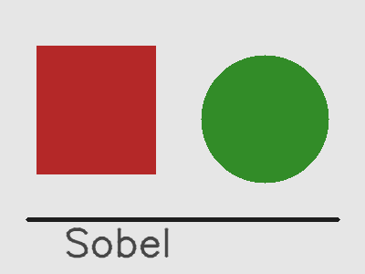
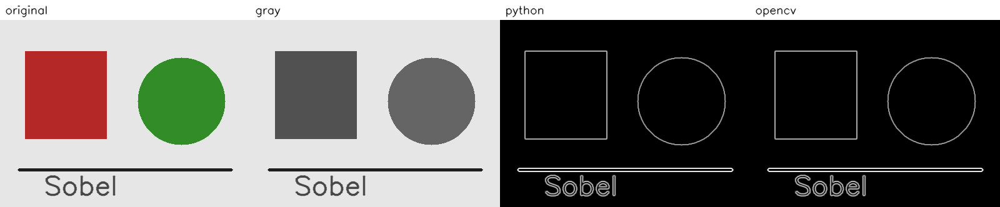
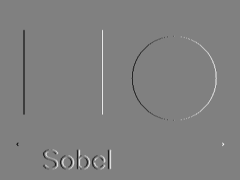
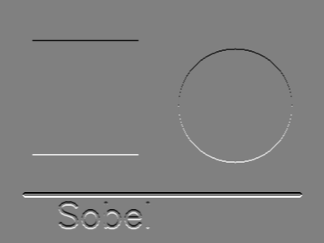
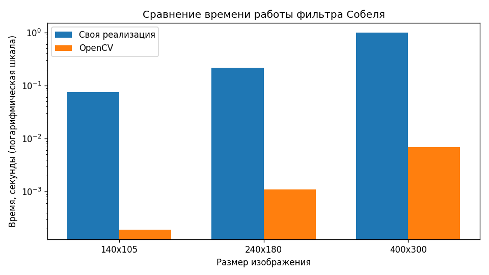

# Лабораторная работа 1. Фильтр Собеля

Вариант 1: фильтр Собеля. Программа на Python, алгоритм написан дважды: своими циклами и через OpenCV. Ниже отчёт по пунктам из задания.

## Запуск

```bash
pip install -r requirements.txt
python main.py
```

Своя картинка:

```bash
python main.py --image путь\к\фото.jpg
```

Если сторону не передать, берётся `images/test.png` (квадрат, круг, линия и надпись). Картинки шире или выше 500 пикселей уменьшаются: циклы на Python иначе считаются слишком долго. Результаты пишутся в папку `results`.

Файлы:

- `sobel.py` — перевод в яркость и оба варианта фильтра
- `main.py` — чтение картинки, замер времени, сохранение результатов

## 1. Теоретическая база

Фильтр Собеля ищет границы: места, где яркость резко меняется. Для этого он оценивает градиент изображения.

Градиент — это пара производных:

- `gx` — насколько яркость меняется слева направо
- `gy` — насколько яркость меняется сверху вниз

На дискретной картинке производную заменяют свёрткой с ядром 3×3. Ядра Собеля:

```
GX = -1  0  1      GY = -1  -2  -1
     -2  0  2            0   0   0
     -1  0  1            1   2   1
```

Для каждого пикселя берётся его окрестность 3×3, умножается на ядро и суммируется. Центральный столбец у `GX` и центральная строка у `GY` нулевые, а соседние пиксели входят с весом 1 или 2. Двойка стоит ближе к центру, поэтому ближайшие соседи влияют сильнее.

Сила границы — модуль градиента:

```
magnitude = sqrt(gx * gx + gy * gy)
```

Направление границы тоже можно посчитать как угол `atan2(gy, gx)`, но для картинки границ хватает модуля. Чем больше модуль, тем резче перепад яркости.

Перед фильтром изображение переводится в яркость. У цветной картинки три канала, а граница — это скачок яркости, цвет для этого не нужен. Используется та же формула, что в OpenCV:

```
Y = 0.299 * R + 0.587 * G + 0.114 * B
```

## 2. Описание разработанной системы

Программа устроена линейно.

1. Читает изображение (`cv2.imread`). Если файла нет, создаёт тестовую картинку.
2. Если сторона больше 500 пикселей, уменьшает её.
3. Считает яркость функцией `to_grayscale`.
4. Прогоняет фильтр Собеля двумя способами и засекает время.
5. Сохраняет яркость, производные, модуль градиента, карту разницы и график.

### Своя реализация

Функция `sobel_python` в `sobel.py`. Пиксели лежат в массиве NumPy, так удобно читать картинку. Сам фильтр считается циклами, без `cv2.Sobel` и без свёртки из библиотеки.

Для пикселя `(x, y)` окно 3×3 умножается на `GX` и `GY`. Модуль считается сразу:

```python
magnitude = math.sqrt(gx * gx + gy * gy)
```

Край шириной в 1 пиксель не обрабатывается: окно 3×3 вышло бы за границу. Там остаётся 0.

### Реализация на OpenCV

Функция `sobel_opencv`. Горизонтальную и вертикальную производные считает `cv2.Sobel` с `ksize=3` — это те же ядра 3×3. Модуль считается той же формулой `sqrt(gx^2 + gy^2)`, чтобы сравнивать сам оператор, а не разные способы нормировки.

OpenCV на краю достраивает пиксели за границей картинки, поэтому рамка может отличаться от своей версии. Внутри изображения формулы совпадают.

### Замер времени

`time.perf_counter` оборачивает только вызов фильтра, без чтения и записи файлов. Своя реализация усредняется по 3 запускам, OpenCV по 10: у OpenCV один запуск длится миллисекунды, и одиночное измерение слишком шумное. Дополнительно фильтр гоняется на уменьшенных копиях 35% и 60%, чтобы увидеть, как время растёт с размером. Шкала графика логарифмическая, иначе столбец OpenCV на фоне своей реализации почти не виден.

## 3. Результаты работы и тестирования

Тест: `images/test.png`, 400×300.



Слева направо: исходное, яркость, модуль своей реализации, модуль OpenCV.



Обе версии находят одни и те же контуры: стороны квадрата, окружность, горизонтальную линию и буквы. Заливка внутри фигур чёрная, потому что яркость там почти не меняется.

Отдельно сохранены производные своей реализации. Серый цвет — ноль, тёмное — отрицательное значение, светлое — положительное.

`gx` реагирует на вертикальные границы. У квадрата левый край тёмный, правый светлый: слева яркость падает (фон светлее фигуры), справа растёт.



`gy` реагирует на горизонтальные границы: верх и низ квадрата, линия под фигурами.



Сравнение чисел на внутренней части (без рамки в 1 пиксель), один запуск на этой машине:

| | значение |
|---|---|
| средняя абсолютная разница | 2.430×10⁻¹⁵ |
| максимальная абсолютная разница | 1.137×10⁻¹³ |

Это погрешность вещественных чисел, а не разные границы. Карта разницы из-за этого чёрная: `results/difference.png`.

Время, среднее по повторам:

| размер | пикселей | своя реализация, с | OpenCV, с | во сколько раз OpenCV быстрее |
|---|---:|---:|---:|---:|
| 140×105 | 14 700 | 0.075 | 0.000193 | 386 |
| 240×180 | 43 200 | 0.215 | 0.001088 | 197 |
| 400×300 | 120 000 | 0.985 | 0.006823 | 144 |



От 140×105 к 240×180 пикселей больше в 2.9 раза, время своей реализации тоже выросло примерно в 2.9 раза (0.075 с → 0.215 с). На 400×300 пикселей больше ещё в 2.8 раза, а время выросло сильнее, примерно в 4.6 раза. У OpenCV на этом шаге время тоже выросло сильнее, чем число пикселей. Значит, последний замер замедлил сам компьютер, а не формула. Порядок при этом устойчивый: своя версия — десятые доли секунды и около секунды, OpenCV — миллисекунды. Повторный запуск даст другие цифры, соотношение останется тем же.

Цифры этого прогона лежат в `results/timings.txt`.

## 4. Выводы

Фильтр Собеля сводится к двум свёрткам 3×3 и модулю градиента. Своя реализация на циклах и `cv2.Sobel` дают одну и ту же карту границ: внутри картинки разница на уровне 10⁻¹³.

Своя версия короткая и по ней видно, что именно считается. На картинке 400×300 она занимает около секунды, потому что каждый пиксель обрабатывается интерпретатором Python. OpenCV считает тот же фильтр за несколько миллисекунд: библиотека написана на C++ и обходит матрицу гораздо быстрее. На этих замерах разница получилась примерно в 150–400 раз.

Время растёт вместе с числом пикселей. Для большой фотографии свою версию без уменьшения картинки запускать неудобно, поэтому в программе сторона ограничена 500 пикселями.

## 5. Использованные источники

1. Gonzalez R. C., Woods R. E. Digital Image Processing. — Pearson. Оператор Собеля в разделе про выделение границ.
2. Sobel I., Feldman G. A 3×3 Isotropic Gradient Operator for Image Processing. — Stanford Artificial Intelligence Project, 1968.
3. Документация OpenCV, функция `Sobel`: <https://docs.opencv.org/4.x/d4/d86/group__imgproc__filter.html>
