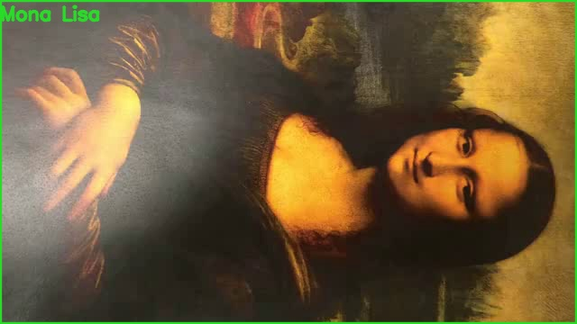
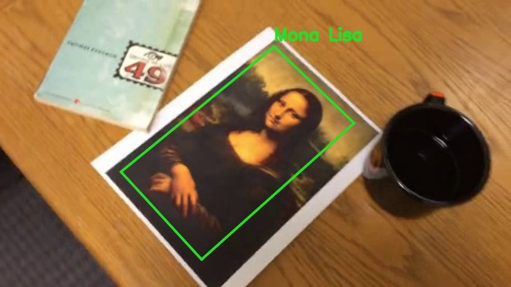
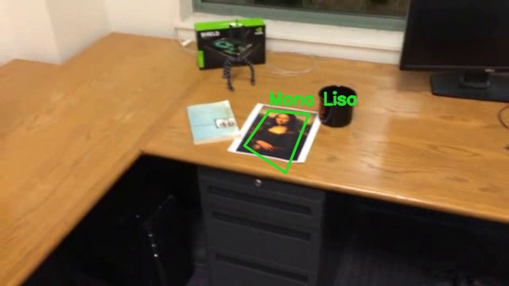
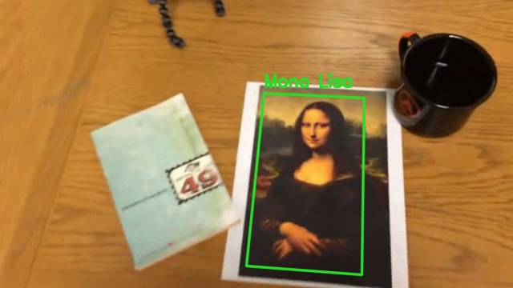
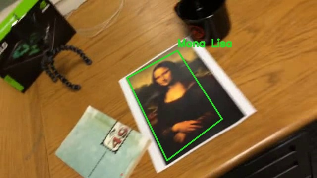
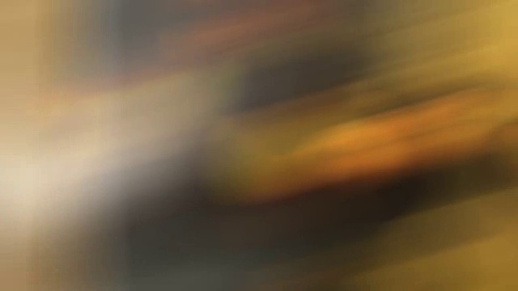
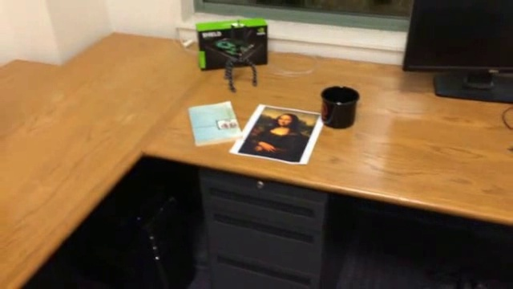

# Лабораторная работа 2. Трекинг объекта по ключевым точкам

Программа находит на видео плоский объект. Эталон — первый кадр: крупный показ объекта. На кадрах, где объект виден, рисуется четырёхугольная рамка и подпись. Рамка повторяет наклон листа, а не просто прямоугольник по сторонам кадра.

Своё видео можно прогнать той же командой, когда оно будет. В этот отчёт оно не входит.

## Запуск

```bash
pip install -r requirements.txt
python main.py
```

Без аргументов обрабатываются три ролика из `data/`:

- `mona-lisa.avi`
- `mona-lisa-blur.avi`
- `mona-lisa-blur-extra-credit.avi`

Своё видео:

```bash
python main.py путь\к\видео.mp4 --label "Object"
```

Первый кадр своего ролика должен быть крупным изображением объекта, дальше объект должен попадать в кадр. Подпись рисуется шрифтом OpenCV, он умеет латиницу.

Файлы:

- `tracker.py` — поиск объекта
- `main.py` — чтение видео, рамка, сохранение результата

Готовые ролики лежат в `results/`, отдельные кадры — в `results/shots/`.

## 1. Теоретическая база

Объект на видео плоский: это лист с картиной. Плоский предмет в другом ракурсе связан с эталоном гомографией — матрицей 3×3. Она переводит точки эталона в точки текущего кадра. Достаточно четырёх пар точек, остальные пары нужны, чтобы отбросить ошибки.

Пары точек берутся из ключевых точек. Ключевая точка — устойчивое место на картинке, чаще угол или пятно текстуры. У «Моны Лизы» текстуры много: лицо, складки, фон картины. Вокруг каждой точки считается дескриптор, вектор, который описывает окрестность и почти не меняется при повороте и масштабе.

В программе детектор — SIFT. Он строит пирамиду масштабов и для каждой точки собирает гистограмму направлений градиента. Поэтому одна и та же деталь на крупном первом кадре и на мелком листе в конце ролика может получить похожий дескриптор.

Совпадение точек — ближайший дескриптор. Одного ближайшего мало: у однотонного стола много похожих точек. Оставляем пару, только если лучший кандидат заметно ближе второго (порог 0.75, тест Лоу). Из оставшихся пар RANSAC оценивает гомографию и выкидывает несогласованные точки.

Углы эталона (весь первый кадр) переводятся этой матрицей в текущий кадр. Получается четырёхугольник по границе объекта.

Когда лист далеко, дескрипторов на нём мало, и сравнение с эталоном не набирает нужное число точек. Тогда те же точки сдвигаются оптическим потоком Лукаса–Канаде: ищется, куда уехал маленький участок с предыдущего кадра на текущий. По новым координатам гомография считается снова.

На сильном смазе устойчивых точек нет. Рамка в этом случае не рисуется: объект на кадре не виден.

## 2. Описание разработанной системы

На каждом кадре `ObjectTracker.locate` делает два шага.

1. Сравнение с эталоном. SIFT на текущем кадре, сопоставление с точками первого кадра, тест Лоу, `findHomography` с RANSAC. Рамка принимается, если внутренних точек не меньше 12 и четырёхугольник правдоподобный: выпуклый, не крошечный и не вылезает далеко за кадр.
2. Если сравнение не удалось, оптический поток по точкам, которые уже были на прошлом кадре. Здесь хватает 8 точек: движение между соседними кадрами небольшое.

Если оба шага не удались, старые точки забываются. Иначе на следующем кадре поток сравнивал бы координаты не с тем изображением.

Подпись `Mona Lisa` ставится у верхнего угла рамки.

`main.py` читает видео, рисует рамку и пишет результат в `results/<имя>.mp4`. Для отчёта сохраняются кадры 0, 18, 80, 200, 400 и 520.

## 3. Результаты работы и тестирования

Ролики 640×360, 558 кадров, около 30 кадров в секунду. Первые кадры — крупный фрагмент картины. Дальше камера отъезжает, лист лежит на столе среди книги и кружки, в конце снова приближается.

| видео | кадров с рамкой | без рамки |
|---|---:|---:|
| mona-lisa.avi | 558 | 0 |
| mona-lisa-blur.avi | 539 | 19 |
| mona-lisa-blur-extra-credit.avi | 325 | 233 |

На чистом ролике рамка есть на всех кадрах. В начале она совпадает с границами кадра: объект и есть весь первый кадр.



Когда камера отъезжает, четырёхугольник ложится на саму картину. Белое поле листа в эталон не входило, поэтому рамка идёт по изображению, а не по бумаге.





При повторном приближении рамка снова закрывает лист и повторяет его поворот.





В `mona-lisa-blur.avi` кадры 10–28 сильно смазаны. Рамки на них нет, на остальных 539 кадрах она есть. После смаза объект находится снова, потому что сравнение с первым кадром не зависит от потерянного потока.



В `mona-lisa-blur-extra-credit.avi` таких провалов три:

- кадры 11–29 — смаз в начале, как во втором ролике;
- кадры 174–378 — лист далеко, точек для нового сравнения с эталоном не хватает, а цепочка потока к этому месту уже оборвалась;
- кадры 391–399 — второй смаз.

Пока лист мелкий, рамка пропадает. Когда камера снова приближает его, SIFT набирает достаточно совпадений, и рамка возвращается.




Книга и кружка рядом с листом в рамку не попадают: их дескрипторы не совпадают с эталоном, RANSAC их не берёт в гомографию.

## 4. Выводы

Плоский объект с богатой текстурой находится по ключевым точкам SIFT и гомографии. Рамка получается четырёхугольной и повторяет наклон листа.

Сравнение с первым кадром само по себе теряет объект, когда он занимает мало пикселей. Оптический поток дотягивает рамку между кадрами, пока точки не потерялись. Поэтому на чистом ролике пропусков нет, а на ролике с двумя смазами дальний кусок выпадает: после смаза зацепиться не за что, пока лист снова не станет крупным.

Смазанные кадры программа пропускает. Это ожидаемо: на них нет устойчивых ключевых точек, и рисовать рамку было бы гаданием.

Своё видео запускается той же программой. Для него важен крупный первый кадр и объект с текстурой, не однотонный лист.

## 5. Использованные источники

1. Lowe D. G. Distinctive Image Features from Scale-Invariant Keypoints // International Journal of Computer Vision. 2004. Детектор SIFT и отсев совпадений по отношению расстояний до двух ближайших соседей.
2. Lucas B. D., Kanade T. An Iterative Image Registration Technique with an Application to Stereo Vision // Proceedings of Imaging Understanding Workshop. 1981. Оптический поток.
3. Hartley R., Zisserman A. Multiple View Geometry in Computer Vision. Cambridge University Press. Гомография плоскости.
4. Документация OpenCV: `SIFT`, `findHomography`, `calcOpticalFlowPyrLK`. <https://docs.opencv.org/4.x/d1/de0/tutorial_py_feature_homography.html>
