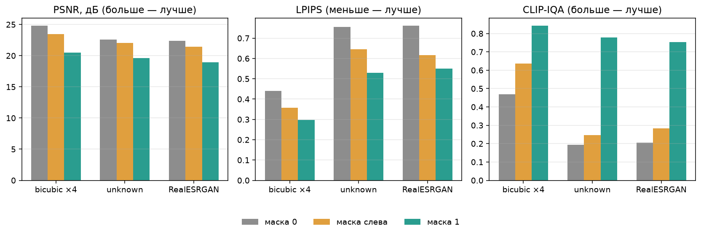
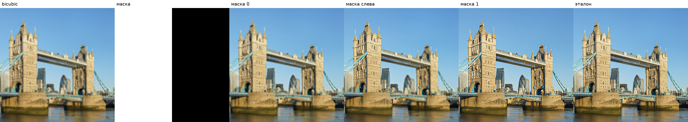
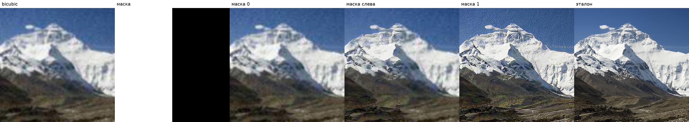
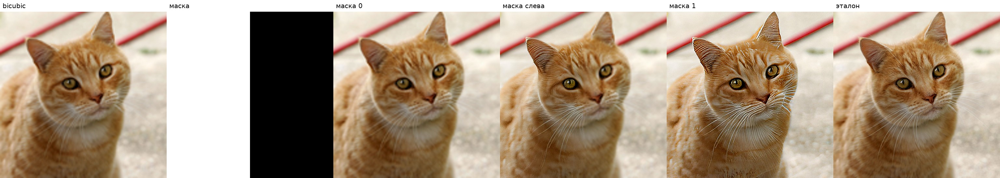
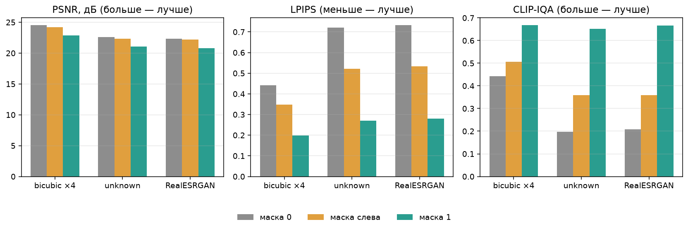
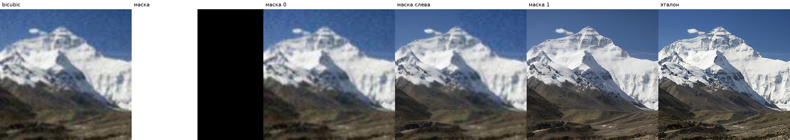
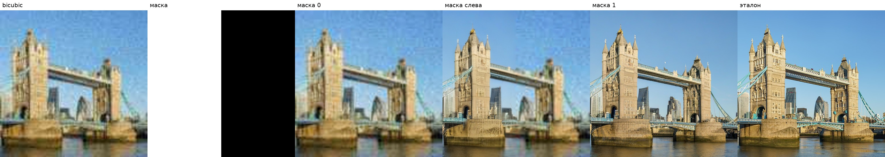

# Лабораторная работа 3. Сверхразрешение по маске

Диффузионная модель увеличивает кадр в четыре раза. В обычном режиме она переписывает всё изображение. Здесь цикл сэмплинга изменён: модель восстанавливает только фрагмент, отмеченный бинарной маской. Остальное остаётся bicubic-увеличением.

Один и тот же опыт прогнан на двух моделях. Первая — Stable Diffusion x4 Upscaler, это baseline. Вторая — SUPIR, модель из задания. Цифры baseline лежат в `results/`, цифры SUPIR — в `results_supir/`.

## Запуск

Нужна видеокарта. Модель в fp16 занимает около 6 ГБ.

```bash
pip install torch torchvision --index-url https://download.pytorch.org/whl/cu128
pip install -r requirements.txt
python experiment.py
```

Скрипт сам скачивает три фотографии и веса `stabilityai/stable-diffusion-x4-upscaler`. Результат появляется в `results/`: таблица метрик, график и сравнения.

SUPIR считается отдельно. Ему нужен клон [Fanghua-Yu/SUPIR](https://github.com/Fanghua-Yu/SUPIR) в `PYTHONPATH`, веса SDXL и `SUPIR-v0Q`, и своё окружение: у официального кода другие версии библиотек, чем у baseline. Подпись кадра фиксированная, та же, что у baseline. LLaVA в прогон не входит. Метрики считает окружение baseline: там стоят PSNR, LPIPS и CLIP-IQA.

```bash
python experiment_supir.py --supir-root /path/to/SUPIR --weights /path/to/weights
python score_supir.py
```

Файлы:

- `sampler.py` — цикл DDIM с маской для x4-upscaler
- `supir_mask.py` — то же правило в семплере EDM у SUPIR
- `degrade.py` — три деградации и три маски
- `metrics_eval.py` — PSNR, LPIPS, CLIP-IQA
- `experiment.py` — прогон baseline
- `experiment_supir.py` — прогон SUPIR
- `score_supir.py` — метрики и полоски сравнения для SUPIR

Прогон baseline: 25 шагов DDIM, guidance 7.5, `noise_level` 20, seed 42. Прогон SUPIR: 25 шагов EDM, guidance 4.0, `s_churn` 0, `restore_cfg` −1, seed 42. Цветовая коррекция на весь кадр выключена: wavelet и AdaIN переписали бы и нули маски. Видеокарта — NVIDIA H100.

## 1. Теоретическая база

Диффузионная модель учится убирать шум. На обучении к чистому изображению много раз подмешивают гауссов шум, пока от картинки ничего не остаётся. Сеть на каждом уровне шума предсказывает, как сделать шаг назад. На выводе начинают с чистого шума и за десятки шагов приходят к изображению. Это обратный процесс, сэмплинг.

В латентной диффузии сеть работает не с пикселями, а с коротким кодом картинки. Кодер VAE сжимает кадр, декодер разворачивает код обратно. UNet предсказывает шаг в этом коде. Так сверхразрешение помещается в память: код входа 128×128, а декодер этой модели разворачивает его в кадр 512×512, то есть увеличивает в четыре раза.

Выбранная модель — Stable Diffusion x4 Upscaler. Это image-to-image: малое изображение не просто подсказка в тексте, а отдельный вход UNet. К зашумлённому латенту по каналам приклеивается сам малый кадр, и сеть видит, что именно нужно увеличить. Текст задаёт общий характер кадра. В прогоне промпт один и тот же для всех картинок: `sharp, detailed, high resolution photograph`.

Полное восстановление не всегда нужно. У участка может быть свой источник, или резкость нужна только внутри объекта. Задание как раз про это: SR-inpainting, сверхразрешение внутри маски.

Маска — бинарный массив того же размера, что вход модели. Единица означает «этот участок восстанавливает диффузия». Ноль означает «оставить простое увеличение». Маска не подаётся в UNet отдельным каналом. Она вмешивается в сэмплинг, по схеме RePaint.

На шаге сеть предлагает следующий латент. Вне маски это предложение выбрасывается. Туда подставляется латент bicubic-увеличения, зашумлённый ровно до текущего уровня. Внутри маски остаётся предложение сети. К последнему шагу шум обнуляется: вне маски лежит код bicubic-кадра, внутри — то, что дорисовала модель. Декодер собирает из этого один кадр. Граница маски видна, потому что маска жёсткая, без растушёвки.

Качество считается тремя метриками.

- PSNR сравнивает результат с эталоном попиксельно. Выше — ближе к исходным числам. Гладкое увеличение часто выигрывает у генеративной модели: выдуманная шерсть или кладка не совпадает с пикселями фотографии.
- LPIPS тоже сравнивает с эталоном, но по признакам сети, а не по яркости. Ниже — ближе по восприятию.
- CLIP-IQA эталон не использует. Модель CLIP оценивает, насколько кадр выглядит качественным. Выше — лучше.

## 2. Описание разработанной системы

В задании рекомендован SUPIR. Это тоже латентная диффузия сверхразрешения, только на SDXL. Сначала сделана модель поменьше: у неё цикл читается целиком в `sampler.py`, и по ней видно, что маска вообще работает. Затем то же правило перенесено в семплер SUPIR, файл `supir_mask.py`. Сеть другая, шаг другой, а подмена вне маски та же.

На каждом кадре система делает четыре вещи.

1. Готовит вход 128×128 одной из трёх деградаций. Эталон при этом — центральный квадрат 512×512.
2. Кодирует bicubic ×4 в латент. Это «известная» картинка для нулей маски.
3. Гоняет DDIM. После шага планировщика латент смешивается с известным по маске.
4. Декодирует латент и считает метрики против эталона.

Три маски, все в разрешении входа 128×128:

- `ones` — все единицы, восстанавливается весь кадр
- `zeros` — все нули, диффузия на каждом шаге выбрасывается, остаётся bicubic
- `combined` — левая половина единицы, правая нули

Три деградации, по типу дорожек DIV2K. Это не файлы из архива DIV2K, а те же виды порчи, наложенные на три фотографии.

- `bicubic` — уменьшение bicubic в четыре раза
- `unknown` — размытие, уменьшение, шум и JPEG
- `realesrgan` — два прохода в духе Real-ESRGAN: размытие, ресайз, шум, JPEG, затем финальный размер 128×128

Для сравнения в таблицу добавлен ещё чистый bicubic ×4 без прохода через VAE. Нулевая маска должна с ним почти совпасть: если совпадает, смешивание в сэмплинге действительно удерживает известный кадр.

Системные требования baseline: Python 3.10+, CUDA, пакеты из `requirements.txt`. VAE считается в float32, UNet и текстовый энкодер — в float16.

### SUPIR

SUPIR считает шаг иначе. Его семплер — EDM: состояние латента при уровне шума sigma равно чистому коду плюс гауссов шум, умноженный на sigma. После шага сети вне маски подставляется код bicubic-увеличения с тем же sigma. Когда sigma падает до нуля, снаружи остаётся чистый bicubic, внутри — то, что восстановила модель.

Вход SUPIR — испорченный кадр, заранее растянутый bicubic до 512. Кодер VAE у SDXL сжимает его в латент 64×64. У x4-upscaler латент входа был 128×128: там другая степень сжатия. Маска растягивается до латента SUPIR ближайшим соседом. Промпт тот же. Отдельная подпись LLaVA не считается: для проверки маски хватает фиксированного текста, а сама подпись тяжелее диффузии.

`s_churn` равен нулю, поэтому между шагами сеть не подмешивает лишний шум. `restore_cfg` отрицательный, и штатное притяжение SUPIR к первому каскаду выключено: иначе оно тянуло бы кадр к bicubic и внутри маски. Guidance 4 — настройка SUPIR в сторону сходства с входом. UNet в float16, автокодировщик в bfloat16.

## 3. Результаты работы и тестирования

Три кадра: кот, Тауэрский мост, северный склон Эвереста. Фотографии с Wikimedia Commons, кроп 512×512. На каждом — три деградации и три маски, всего 27 прогонов модели. В таблице средние по трём кадрам. Полные числа лежат в `results/metrics.csv`.

| деградация | маска | PSNR, дБ | LPIPS | CLIP-IQA |
|---|---|---:|---:|---:|
| bicubic ×4 | 0 | 24.80 | 0.441 | 0.470 |
| bicubic ×4 | слева | 23.46 | 0.357 | 0.636 |
| bicubic ×4 | 1 | 20.48 | 0.298 | 0.842 |
| unknown | 0 | 22.61 | 0.755 | 0.195 |
| unknown | слева | 22.02 | 0.645 | 0.247 |
| unknown | 1 | 19.60 | 0.529 | 0.778 |
| RealESRGAN | 0 | 22.39 | 0.761 | 0.205 |
| RealESRGAN | слева | 21.43 | 0.617 | 0.283 |
| RealESRGAN | 1 | 18.94 | 0.550 | 0.753 |



PSNR падает от нулевой маски к полной: диффузия уходит от пикселей эталона. LPIPS и CLIP-IQA идут в другую сторону. Полная маска выглядит резче и по признакам ближе к фотографии, хотя по яркостям совпадает хуже. Комбинированная маска почти везде оказывается между ними.

Нулевая маска совпадает с чистым bicubic. Разница PSNR на каждом кадре меньше 0.1 дБ. Проход через VAE картинку заметно не портит, и нули маски действительно отключают восстановление.

Маска действует локально. Для bicubic ×4 средний PSNR левой половины: 24.49 при нулевой маске, 22.36 при комбинированной, 20.15 при полной. Правая половина у нулевой и комбинированной масок совпадает: 25.14 дБ и там, и там. Правая сторона не восстанавливалась, левая — восстанавливалась.

На мосте при честном bicubic это видно по архитектуре. Нулевая маска мыльная, как увеличение. Полная маска собирает окна и подвесы. Комбинированная резкая слева и мягкая справа, по шву.



На сильной деградации шов ещё заметнее. У Эвереста после RealESRGAN правая половина остаётся размытой, левая получает фактуру снега и камней. Фактура не копирует эталон: сеть дорисовывает её из малого кадра.



Кот — гладкий сюжет. При bicubic ×4 полная маска поднимает CLIP-IQA с 0.41 до 0.87, но LPIPS становится хуже: 0.376 против 0.280 у нулевой маски. Сеть прорисовывает шерсть, которой в эталоне нет, и расстояние по признакам растёт. На мосте и горе, где в эталоне много мелкой структуры, LPIPS у полной маски лучше.



На unknown у моста полная маска поднимает CLIP-IQA с 0.18 до 0.65, и при этом небо становится зернистым. Сеть принимает следы JPEG за деталь и рисует её заново. Оценка «качества» без эталона такое зерно одобряет. PSNR при этом самый низкий.


На двух кадрах с unknown комбинированная маска по CLIP-IQA чуть ниже нулевой: 0.169 против 0.177 у моста и 0.130 против 0.160 у горы. Шов между резкой и мыльной половинами для беэталонной оценки хуже, чем равномерно мягкий кадр. В среднем по трём фотографиям комбинированная маска всё равно выше.

### SUPIR

Те же три кадра, те же деградации и те же маски. 27 прогонов. В таблице средние по трём кадрам. Полные числа лежат в `results_supir/metrics.csv`.

| деградация | маска | PSNR, дБ | LPIPS | CLIP-IQA |
|---|---|---:|---:|---:|
| bicubic ×4 | 0 | 24.53 | 0.441 | 0.442 |
| bicubic ×4 | слева | 24.18 | 0.348 | 0.506 |
| bicubic ×4 | 1 | 22.89 | 0.199 | 0.668 |
| unknown | 0 | 22.60 | 0.721 | 0.198 |
| unknown | слева | 22.34 | 0.521 | 0.358 |
| unknown | 1 | 21.06 | 0.271 | 0.652 |
| RealESRGAN | 0 | 22.32 | 0.733 | 0.208 |
| RealESRGAN | слева | 22.19 | 0.533 | 0.359 |
| RealESRGAN | 1 | 20.82 | 0.280 | 0.667 |



Порядок масок тот же, что у baseline. PSNR выше у нулевой маски, LPIPS и CLIP-IQA лучше у полной. Комбинированная лежит между ними. Правая половина при bicubic ×4 у нулевой и комбинированной масок почти совпадает: 24.86 и 24.84 дБ. Левая падает: 24.22 при нулевой, 23.60 при комбинированной, 22.51 при полной. Маска локальна и в семплере EDM.

Нулевая маска близка к чистому bicubic. Зазор больше, чем у x4-upscaler: там разница была меньше 0.1 дБ, здесь в среднем около 0.25 дБ, а у кота 0.45 дБ (31.04 против 31.48). Известный кадр проходит через VAE SDXL и обратно, и этот круг чуть сильнее трогает пиксели. Правые половины при этом совпадают, так что нули маски восстановление отключают.

На полной маске SUPIR держится ближе к эталону, чем x4-upscaler. При bicubic ×4 средний PSNR 22.89 против 20.48, LPIPS 0.199 против 0.298. CLIP-IQA при этом ниже: 0.668 против 0.842. Меньшая модель сильнее дорисовывает резкую фактуру, и беэталонная оценка это одобряет. SUPIR меньше отходит от фотографии, поэтому PSNR и LPIPS у него лучше, а CLIP-IQA скромнее. На unknown и RealESRGAN то же самое: LPIPS полной маски 0.271 и 0.280 у SUPIR, 0.529 и 0.550 у x4-upscaler.

У кота разница особенно ясная. На bicubic ×4 полная маска x4-upscaler ухудшала LPIPS: 0.376 против 0.280 у нулевой маски, сеть выдумывала шерсть. У SUPIR полная маска LPIPS улучшает: 0.116 против 0.288. Шерсть остаётся ближе к фотографии.


Шов на комбинированной маске остаётся. На Эвересте после RealESRGAN левая половина получает фактуру склона, правая остаётся размытым увеличением.



На unknown у моста полная маска поднимает CLIP-IQA с 0.20 до 0.61. Кадр резче нулевой маски, а кладка и небо собраны заново из испорченного входа. PSNR при этом ниже нулевой маски: 18.74 против 19.76.



## 4. Выводы

Сэмплинг диффузионного сверхразрешения можно ограничить маской, не дообучая сеть. На каждом шаге вне маски латент заменяется зашумлённым bicubic. Нулевая маска повторяет простое увеличение, полная отдаёт кадр модели, комбинированная режет кадр по границе.

Метрики расходятся, и это ожидаемо. PSNR выше там, где модель ничего не придумывает. LPIPS и CLIP-IQA выше там, где она добавляет резкость. Для фрагмента, который нужно сохранить как есть, подходит ноль. Для фрагмента, который нужно дорисовать, подходит единица. Жёсткая маска оставляет шов: соседние пиксели приходят из разных процессов.

То же правило маски переносится на SUPIR с семплером EDM. Нулевая маска снова близка к bicubic, полная отдаёт кадр модели, комбинированная режет его пополам. От модели зависит, насколько сильно сеть отходит от эталона. x4-upscaler сильнее поднимает CLIP-IQA и сильнее роняет PSNR. SUPIR на полной маске ближе к фотографии: PSNR и LPIPS лучше, CLIP-IQA ниже. Фиксированной подписи для этой проверки хватило.

На сильном шуме и JPEG модель может усилить порчу, а не убрать её. CLIP-IQA это не ловит, потому что эталона у неё нет. Поэтому для такого восстановления одной беэталонной метрики мало: рядом нужны PSNR и LPIPS.

## 5. Использованные источники

1. Ho J., Jain A., Abbeel P. Denoising Diffusion Probabilistic Models. 2020. Прямой и обратный диффузионные процессы.
2. Song J., Meng C., Ermon S. Denoising Diffusion Implicit Models. 2020. Сэмплер DDIM, которым считается эта модель.
3. Rombach R. et al. High-Resolution Image Synthesis with Latent Diffusion Models. 2022. Диффузия в латентном коде VAE.
4. Lugmayr A. et al. RePaint: Inpainting using Denoising Diffusion Probabilistic Models. 2022. Подмена известной области зашумлённым исходником на каждом шаге.
5. Stability AI. Stable Diffusion x4 Upscaler. Карточка модели: <https://huggingface.co/stabilityai/stable-diffusion-x4-upscaler>
6. Wang X. et al. Real-ESRGAN: Training Real-World Blind Super-Resolution with Pure Synthetic Data. 2021. Двухкаскадная деградация.
7. Zhang R. et al. The Unreasonable Effectiveness of Deep Features as a Perceptual Metric. 2018. LPIPS.
8. Wang J., Chan K. C. K., Loy C. C. Exploring CLIP for Assessing the Look and Feel of Images. 2023. CLIP-IQA.
9. Agustsson E., Timofte R. NTIRE 2017 Challenge on Single Image Super-Resolution. Дорожки DIV2K: bicubic и unknown.
10. Yu F. et al. Scaling Up to Excellence: Practicing Model Scaling for Photo-Realistic Image Restoration In the Wild (SUPIR). CVPR 2024. Вторая модель отчёта. Семплер EDM, вне маски латент заменяется известным кодом с тем же уровнем шума.
